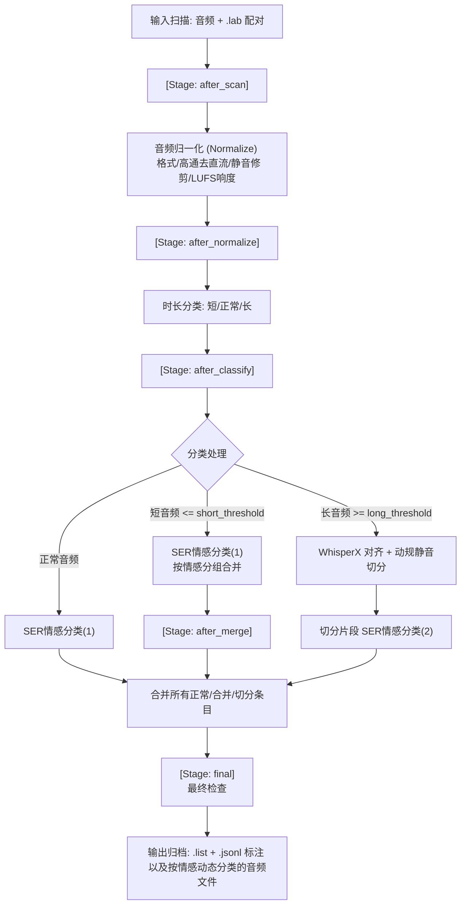

# 音频预处理工具 (Audio Preprocessing Tool for TTS)

这是一个用于语音合成（TTS）训练的音频数据集预处理工具。它可以自动化处理、清洗和格式化原始音频和文本标注文件，帮助您快速构建高质量的训练数据集。

> **AI 声明**：本仓库由 AI 辅助生成

---

## 1. 简介与工作流设计 (Workflow Overview)

本工具采用阶段驱动（Stage-driven）的设计，将音频元数据审计、格式归一化、质量检测、时长分类、短音频合并、长音频切分及情感分类（SER）串联成一条自动流水线。



---

## 2. 系统准备与安装 (Prerequisites & Installation)

### 外部依赖
* **Python**: 推荐 Python 3.8 - 3.12 版本。
* **FFmpeg**: 必须安装 FFmpeg 并确保其可执行文件路径已添加到系统的 `PATH` 环境变量中。程序将调用 `ffmpeg` 和 `ffprobe` 执行音频转换和响度分析。

### 依赖安装
推荐使用 `uv` 极速安装，或使用传统 `pip` 方式：

```bash
# 使用 uv 运行（推荐）
uv venv
uv pip install -r requirements.txt

# 或使用 pip 安装依赖
python -m venv .venv
.\.venv\Scripts\Activate.ps1
pip install -r requirements.txt
```

### 模型缓存
所有模型（FunASR、WhisperX、HuBERT、emotion2vec、SenseVoice 等）在首次运行时会自动下载，统一缓存于项目根目录下的 `local_model/` 文件夹中。

---

## 3. 快速上手 (Quick Start)

### Step 1: 准备数据
将原始音频文件（支持 `WAV/FLAC/MP3/OGG/AAC/M4A` 格式）和对应的 `.lab` 文本标注文件放入一个文件夹中。支持多层嵌套子文件夹。
例如：
```
input/
└───Data/
    ├───audio1.wav
    ├───audio1.lab
    ├───audio2.flac
    ├───audio2.lab
    └───...
```

### Step 2: 配置 `config.yaml`
在根目录下打开 `config.yaml`。确保修改了以下核心路径与参数：
```yaml
root_dir: './input'   # 输入数据文件夹路径
recursive: true       # 是否递归处理子目录
```

### Step 3: 运行预处理
在根目录下直接执行：
```bash
python main.py
# 或使用 uv 执行
uv run main.py
```
程序运行后，会依次在命令行和日志文件中输出每个阶段的执行情况。处理后的最终产物将输出在 `output` 文件夹中。

---

## 4. 核心配置详解 (Configuration Guide)

### 4.1 检查流水线 (`checks:`)
这是控制数据清洗和剔除逻辑的核心板块。支持的检查项包括格式审计 (`audit`)、削波检测 (`clipping`)、静默比例 (`silence_ratio`) 以及信噪比评估 (`snr`)。

```yaml
checks:
  audit:
    enable: true
    run_at: ["after_scan", "final"]    # 执行阶段
    target_sample_rate: 44100
    target_channels: 1
    target_bit_depth: 16
  clipping:
    enable: true
    run_at: ["after_normalize", "final"]
    reject_action: "isolate"           # 超标处理方式: warn_only (仅警告) | isolate (隔离) | remove (移除)
    clip_threshold: 0.99               # 振幅门限 (0.99 即 ≈ -0.09 dBFS 判定为削波)
    warn_threshold: 0.01               # 削波样本比例 > 1% 警告
    reject_threshold: 0.05             # 削波样本比例 > 5% 拒绝 (仅在 run_at 的最后一个阶段生效)
  silence_ratio:
    enable: true
    run_at: ["after_normalize", "final"]
    reject_action: "isolate"
    top_db: 30                         # 低于峰值此 dB 判定为静音
    warn_threshold: 0.4                # 静默比例 > 40% 警告
    reject_threshold: 0.7              # 静默比例 > 70% 拒绝
  snr:
    enable: true
    run_at: ["after_normalize", "final"]
    reject_action: "isolate"
    top_db: 30                         # 用于 VAD 的语音与噪声分离门限
    warn_db: 20                        # 信噪比 < 20dB 警告
    reject_db: 15                      # 信噪比 < 15dB 拒绝
```

### 4.2 音频归一化 (`audio:`)
控制音频的重采样、声道合并、位深归一化、首尾静音切除以及 LUFS 感知响度归一化。
> **注意**：如果配置文件中缺失整个 `audio:` 配置段，程序将不执行任何音频修改（退化为旧版的只读/纯分析模式）。

```yaml
audio:
  target_sample_rate: 44100   # 目标采样率 (Hz)
  target_channels: 1          # 目标声道数 (TTS/SVC 训练推荐 1 单声道)
  target_bit_depth: 16        # 目标位深 (16-bit PCM WAV)
  input_formats: ["wav", "flac", "mp3", "ogg", "aac", "m4a"] # 多格式支持与优先级

  # 直流偏移消除
  dc_offset_removal:
    enabled: true             # 注意为 enabled
    threshold: 0.001          # 直流分量均值大于此值才消除，使用 ffmpeg highpass=f=5

  # 首尾静音修剪
  trim_silence:
    enabled: true             # 注意为 enabled
    top_db: 30                # 相对峰值的静音门限 (dB)
    frame_length: 2048
    hop_length: 512
    min_trim_ms: 100          # 至少修剪 100ms 才处理
    keep_padding_ms: 50       # 修剪后前后保留的静音缓冲时长，防止爆音 (SVC 建议调大)

  # LUFS 响度归一化
  loudness:
    enabled: true             # 注意为 enabled
    target_lufs: -16          # 目标感知响度 (TTS 建议 -16 到 -19; SVC 建议 -18 以保留动态)
    true_peak: -1.5           # 真实峰值限制 (dBTP)
    lra: 7                    # 响度范围 (LU)
    dual_pass: true           # 双 pass 模式。true: 精确线性增益控制；false: 快速单pass动态压缩。
```

### 4.3 文本清洗与 ASR (`text:` 和 `asr:`)
* **文本繁简转换与正则替换**：在扫描阶段处理 `{ASR}` 占位符时，将 ASR 识别出的语音文本转换为简体字；并执行 `replace_map` 中配置的字符规则清理。
* **特殊占位符支持**：
  * `{SKIP}`: 包含此占位符的条目（如 lab 中包含该标记）将被完全跳过，不录入流水线。
  * `{ASR}`: 将使用 ASR 模型识别结果自动填充该占位符。
```yaml
text:
  t2s: true
  replace_map:
    "「": ""
    "」": ""
    "{NICKNAME}": "{SKIP}"     # 丢弃该音频
    "{PLAYER_NAME}": "{ASR}"   # 自动转写并填充该位置

asr:
  language: "zh"
  funasr:
    model: "FunAudioLLM/SenseVoiceSmall"
    use_vad: true
  whisperx:
    model: "large-v2"          # WhisperX 模型
    batch_size: 16
```

### 4.4 时长分类与切分合并 (`split_and_merge:` 和 `split:`)
* **短音频合并**：音频时长 $\le$ `short_threshold` 的条目被判定为短音频，会按情感分组并拼接（片段间填充 `merge_silence_duration` 秒的静音）。
* **长音频切分**：音频时长 $\ge$ `long_threshold` 的条目被判定为长音频，会利用 `whisperx` 词级对齐、动规寻找最长静音停顿处作为切分点，并自动纠正句首标点符号（将其移至上一句句尾）。切分后单段目标最大时长由 `split.max_duration` 约束。
* **切分失败策略**：`on_split_failure` 控制无法成功切分的音频是隔离 (`isolate`) 还是忽略并继续 (`ignore`)。

```yaml
split_and_merge:
  short_threshold: 3.0          # ≤ 此值为短音频 (会被分组合并)
  long_threshold: 25.0          # ≥ 此值为长音频 (触发自动切分)
  merge_silence_duration: 0.3
  output_to_split_folder: false # 切分后的音频是否单独放入"切分后/"文件夹
  on_split_failure: "ignore"

split:
  device: "auto"
  language: "zh"
  min_duration: 3.0             # 切分后片段最小时长
  max_duration: 25.0            # 切分后片段目标最大时长
  max_segments: 5               # 单个长音频最大切分段数
  split_silence_top_db: 40      # 切分点判定相对门限
  split_min_silence_len_ms: 500 # 判定为切分点的最小静音时长
  split_offset_from_silence_end_ms: 0
```

### 4.5 情感识别后端 (`ser:`)
支持 3 种情绪分类模型作为后端，用于在归一化后对短/正常音频做第一阶段 SER（指导短音频合并），以及在切分后做第二阶段 SER（得到切分段的独立情绪标签）。

```yaml
ser:
  enabled: true                 # 注意为 enabled
  backend: "hubert"             # 后端切换: hubert | emotion2vec | sensevoice
  device: "auto"
  on_failure: "default"         # 推理失败策略: default (转unknown) | truncate_and_retry (截断重试) | isolate (隔离)
```

#### SER 后端能力对比

| 后端名称 | 核心模型 | 最大输入时长 | 情感分类数量 | 特点与局限 |
| :--- | :--- | :--- | :--- | :--- |
| **`hubert`** | `hubert-base-ch-speech-emotion-recognition` | 6s (超时硬截断) | 6 类 | 中文优化好，适合短音频 |
| **`emotion2vec`** | `emotion2vec_plus_large` (~300M) | ~30s (受显存限制) | 9 类 | 泛化能力强，大时长下可能 OOM，支持截断重试 |
| **`sensevoice`** | `SenseVoiceSmall` (~234M) | 无限制 (内置 VAD 分块) | 7 类 | 内置 VAD，运行速度极快，多功能合一 |

---

## 5. 输出文件结构与追溯 (Output Structure)

运行完成后，所有的处理产物都会写入 `output/` 文件夹下。结构如下：

```
output/
└───<角色名>/                             # base_output_dir
    ├───<角色名>.log                     # 本次运行的详细日志
    ├───<角色名>_<emotion>.list          # 启用 SER 时按情感生成的训练标注列表 (路径|角色名|语言|文本)
    ├───<角色名>_<emotion>.jsonl         # 启用 SER 时按情感生成的 JSON 行元数据
    │   (未启用 SER 时为单一 <角色名>.list / <角色名>.jsonl)
    └───<角色名>/                         # output_dir 主产物目录
        ├───！格式审计.after_scan.txt
        ├───！静默比例.after_normalize.txt
        ├───！SNR.after_normalize.txt
        ├───！削波检测.after_normalize.txt
        ├───！合并记录.txt               # 短音频拼接合并的追溯记录
        ├───！切分记录.txt               # 长音频切分的对齐及段落记录
        ├───！去重记录.txt               # 因 .lab 内容 hash 相同而被去重的记录
        ├───！00-25-30_<emotion>.txt     # 各情感累计时长标记空文件 (格式: ！时-分-秒_<emotion>.txt)
        │
        ├───<emotion_1>/                 # 启用 SER 时，音频文件直接按预测情感归类存放
        │   ├───audio1.wav
        │   ├───<角色名>_merge_1.wav      # 合并产生的音频
        │   └───切分后/                  # (仅当 output_to_split_folder: true 时)
        │       ├───audio2_part1.wav
        │       └───audio2_part2.wav
        ├───<emotion_2>/
        │   └───...
        │
        ├───隔离/                        # 质检阶段剔除的不合格音频 (仅 reject_action="isolate" 时)
        │   ├───clipping_after_normalize/
        │   ├───silence_ratio_after_normalize/
        │   └───snr_after_normalize/
        ├───切分失败/                    # 切分失败的长音频 (仅 on_split_failure="isolate" 时)
        └───SER失败/                     # 情感分类失败的音频 (仅 ser.on_failure="isolate" 时)
```

---

## 6. 独立审计模式 (Standalone Audit)

如果不希望真正处理音频，仅仅想对数据集进行快速的“健康体检”，可以使用独立审计工具。该工具会运行全部启用的检查项，**不修改文件、不移动文件、忽略阶段配置及拒绝动作**。

### 运行指令：
```bash
python audio_validator.py <待审计的输入目录> [config.yaml路径]
```
如果没有传入 `config.yaml`，工具将尝试读取当前目录下的 `config.yaml` 或使用默认阈值。

### 审计产物：
审计完成后，报告将输出到 `output/<输入目录名>/<输入目录名>/` 下（与正常处理时的输出路径一致），生成无阶段后缀的报告：
* `！格式审计.txt` — 采样率/位深/声道分布，需重采样或转换格式的文件清单。
* `！削波检测.txt` — 标记峰值超标及削波样本率偏高的文件。
* `！静默比例.txt` — 包含过多静音或整段全静音的音频清单。
* `！SNR.txt` — 评估信噪比低（含背景噪音、电流声）的音频清单。

---

## 7. 开发者与测试指南 (Developer Guide)

本仓库配备了完备的测试套件，用以对格式审计、响度归一化、切分动态规划算法等进行回归验证。

运行所有单元测试：
```bash
uv run pytest tests/
# 或
pytest tests/
```

* 纯算法（无 I/O）验证见 `tests/test_split_algorithms.py`。
* 单元测试配置位于 `pytest.ini`。
